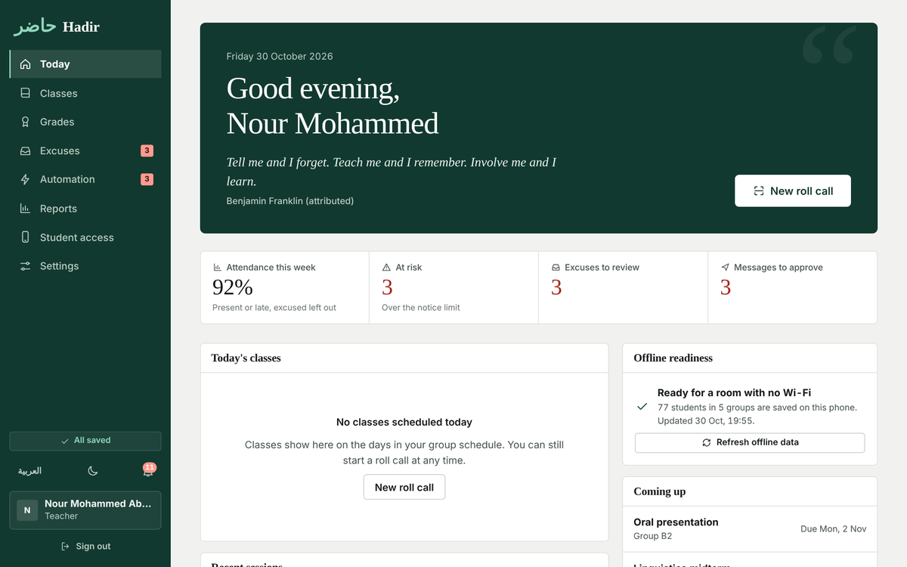
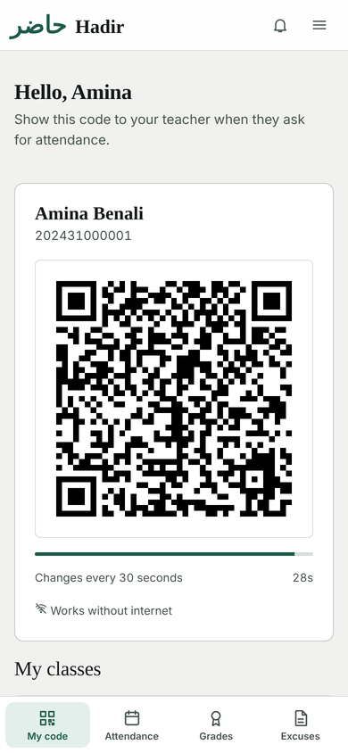
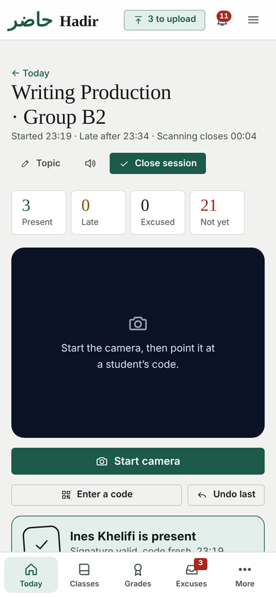
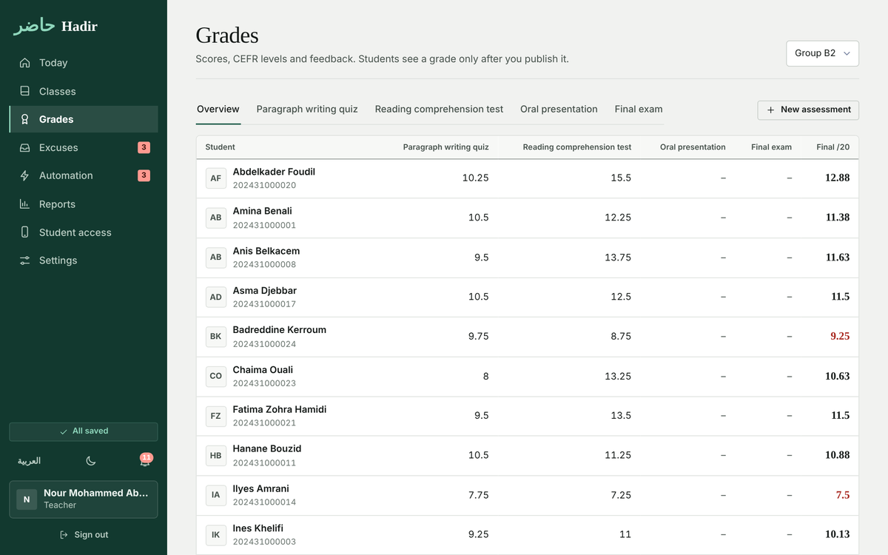
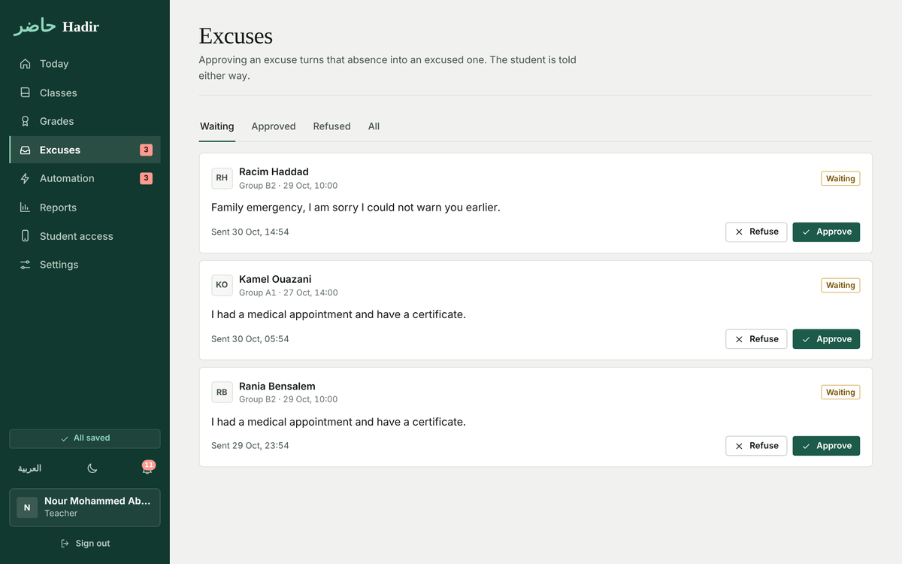
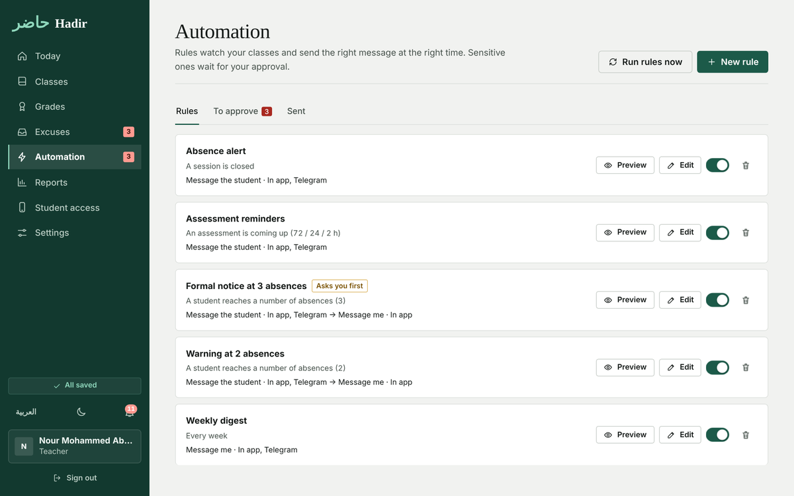
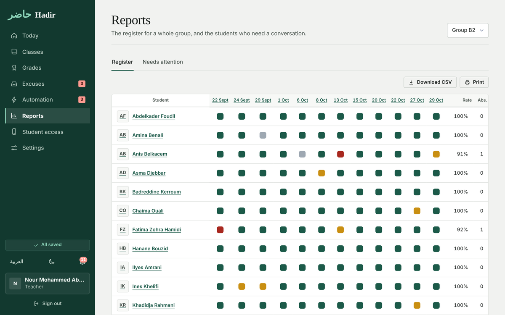
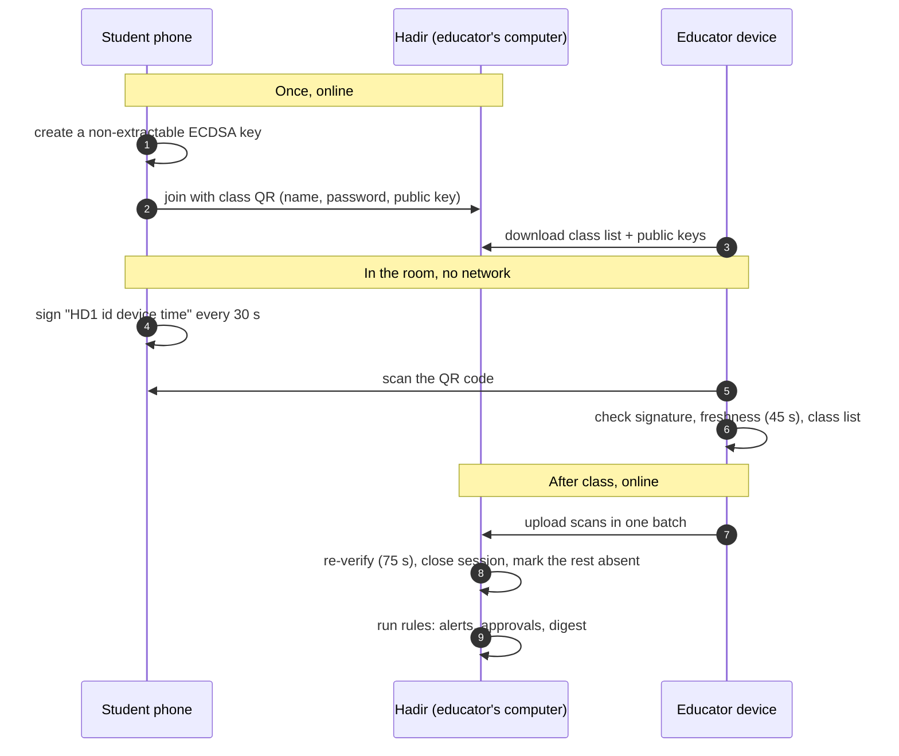
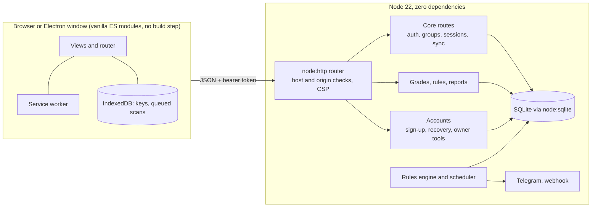

<div align="center">


# Hadir · حاضر

**Offline roll call, grades and follow-up for university educators.**
English and Arabic (RTL). Runs on your own computer. Nothing to host, nothing to pay for.

[](https://github.com/NourTi/Hadir/actions/workflows/desktop.yml)


[Download](https://github.com/NourTi/Hadir/releases/latest) · [How it works](#how-a-class-runs) · [Security](#security) · [Develop](#develop)



</div>

---

## Why Hadir

Calling names costs ten minutes of every class, and "my network failed" is the usual excuse for a missing scan. Hadir takes the network out of the room:

- Each student's phone signs a QR code with a key that **never leaves the phone**, and the code changes every 30 seconds.
- You scan it with a camera. The signature, the time and the class list are checked **on your device**, so roll call works with no internet.
- Absences, excuses, grades, reminders and reports follow from the same data, in one place.

| Student's phone | Educator scanning |
|---|---|
|  |  |

## Features

| Area | What it does |
|---|---|
| **Roll call** | Signed QR codes (ECDSA P-256), verified offline, queued and synced later. Duplicate and forged scans are rejected and shown for review. |
| **Joining** | Students scan one QR per class, type their name (ID optional) and a password, and are enrolled. Rosters can also be pasted from Excel or CSV. |
| **Educator portals** | Sign-up for any educator. Title, university, faculty, department, subjects, colour, defaults for new classes, and a welcome note students see. Educators never see each other's data. |
| **Grades** | Weighted assessments out of 20, CEFR levels for writing and speaking, feedback, and grades students only see once published. |
| **Excuses** | Students upload proof (PDF or image). One-tap approve or refuse, with a note. |
| **Automation** | Rules for absences, upcoming deadlines and a weekly digest, delivered in-app, by Telegram or by webhook. Anything formal waits for approval. Dry-run included. |
| **Reports** | A register matrix per class, an "at risk" list, CSV export and print layout. |
| **Accounts** | Recovery codes, forgot-password flow, owner tools, per-account lockout. |
| **Desktop app** | Windows installer and portable build, data in your own app-data folder. |

<details>
<summary>More screens</summary>

| Grades | Excuses |
|---|---|
|  |  |
| **Automation** | **Reports** |
|  |  |

</details>

## Install

### Desktop app (recommended)

1. Download `Hadir-Setup.exe` (or `Hadir-Portable.exe`) from the [latest release](https://github.com/NourTi/Hadir/releases/latest). Compare it with `SHA256SUMS.txt` on the same page.
2. Windows may show "Windows protected your PC" because the app is not code-signed yet. Choose **More info, Run anyway**.
3. Create your educator account and **save the recovery code**.

Build it yourself on any system:

```bash
git clone https://github.com/NourTi/Hadir.git
cd Hadir/desktop
npm install
npm run dist          # installers appear in desktop/dist
```

### Server (a classroom PC, a Raspberry Pi, a VPS)

```bash
npm start             # http://localhost:3000  (landing page)  and  /app/  (the app)
npm run demo          # sample data and demo sign-in buttons. Never use with real students.
```

Requires Node 22.13 or newer. There are **no runtime dependencies**.

### Connecting students' phones

A phone only creates its signing key on a secure origin. Students therefore need an **https** address that reaches your computer. The simplest free option is a static tunnel domain:

```bash
ngrok http 3977 --url=your-name.ngrok-free.app
```

Paste that address in **Settings, Student address**. Join links and QR codes use it from then on. After a student has joined once, roll call needs no internet in the room.

## How a class runs



## Architecture



### Project structure

```text
server/            http.js router and security headers, db.js schema and migrations,
                   routes-core.js, routes-more.js, routes-accounts.js, engine.js (rules),
                   attendance.js, stats.js, seed.js (demo only)
public/            landing page, /app/ (SPA), /download/ page, service worker, icons
  js/              ES modules: views/, i18n, crypto, QR encoder and decoder, offline queue
  css/             base, app, landing, theme (design tokens, per-educator accents), download
desktop/           Electron wrapper (main.cjs), icons and installer config
scripts/           reset-password.mjs (offline reset), fetch-fonts.mjs, QR verification helpers
test/              node:test suites for API, accounts, join flow, roll call, QR decoder, client
.github/workflows/ desktop.yml: tests, Windows installer, Release with checksums
```

## Security

| Threat | Defence |
|---|---|
| Faked or shared attendance codes | Per-phone non-extractable key, 30 s codes, 45 s tolerance, one scan per student, new phones need approval. |
| Weak or guessed passwords | scrypt hashing, strength rules, per-IP and per-account throttling, lockout after 8 failures (10 min), identical errors and timing for unknown accounts. |
| Forgotten passwords | One-time-shown recovery code (hashed, rotated on use), owner-issued one-time reset codes (24 h), offline `reset-password.mjs`. |
| Stolen sessions | Bearer tokens with a version. Changing or resetting a password, or switching an account off, revokes every session. Educator sessions last 7 days. |
| One educator reading another's data | Every query is scoped by owner. Audit log and exports are per educator. The whole-database backup is owner-only. Another educator's student invite codes are never returned. |
| Local-server attacks (DNS rebinding, cross-site requests) | `Host` must be localhost, an IP, `.local` or an address the owner allowed. Mutating requests with a foreign `Origin` are refused. |
| Injection and XSS | Parameterised SQL, text set with `textContent`, strict CSP (`script-src 'self'`, no third-party requests, fonts bundled), `object-src 'none'`, frame denial. |
| Abuse | Request bodies capped (256 KB, 6 MB for excuse uploads), request timeouts, rate limits on sign-in, sign-up, reset and join. |
| Privacy | No analytics, no external requests. Data lives in the user's app-data folder. |

Found a problem? Please open a private security advisory on the repository rather than a public issue.

## Accounts and recovery

- The **first** account is the **owner** and can close sign-up (Settings, Educators), issue one-time reset codes, set the student address and download a full backup.
- Every educator is shown a **recovery code** once, at sign-up. *Forgot your password?* takes the email, the code and a new password, then issues a new code.
- Lost both? The owner can issue a code. If the owner is locked out, run on that computer:

```bash
node scripts/reset-password.mjs owner@university.dz   # prints a one-time code, valid 24 h
```

Data location: `%APPDATA%\Hadir\data` (Windows), `~/Library/Application Support/Hadir/data` (macOS), `~/.config/Hadir/data` (Linux). The app menu has **Back up now**.

## Configuration

| Variable | Default | Purpose |
|---|---|---|
| `PORT` | `3000` | HTTP port (the desktop app uses `3977`). |
| `DATA_DIR` | `./data` | Database, uploads and daily backups. |
| `HADIR_SECRET` | generated, stored in the database | Signing secret for sessions. |
| `HADIR_PUBLIC_URL` | empty | https address students use. Can also be set in Settings. |
| `HADIR_ALLOWED_HOSTS` | empty | Extra host names allowed when strict host checking is on. |
| `HADIR_STRICT_HOST` | off (on in the desktop app) | Reject unknown `Host` headers. |
| `HADIR_DESKTOP` | off | Desktop mode: strict hosts and desktop defaults. |
| `TELEGRAM_BOT_TOKEN` | empty | Deliver messages through a Telegram bot. |
| `WEBHOOK_URL` | empty | POST rule outputs to this URL. |
| `DEMO_MODE` | off | Seed sample data and enable demo sign-in. **Not for real use.** |

## API at a glance

All routes are JSON under `/api`, authenticated with `Authorization: Bearer <token>` unless marked public.

| Group | Routes |
|---|---|
| Public | `GET /config`, `GET /time`, `POST /auth/login`, `POST /auth/register`, `POST /auth/forgot`, `GET·POST /join/:token` |
| Account | `GET·PATCH /me`, `GET·PUT /me/profile`, `POST /me/recovery`, `GET /export/mine` |
| Owner | `GET /educators`, `POST /educators/:id/reset`, `POST /educators/:id/active`, `POST /settings/registration`, `POST /settings/public-url`, `GET /export/backup` |
| Classes | `GET·POST /groups`, `PATCH /groups/:id`, `GET /groups/:id/roster`, `POST /groups/:id/students`, `POST /groups/:id/join` |
| Roll call | `GET·POST /sessions`, `POST /sessions/:id/close`, `PUT /sessions/:id/attendance/:sid`, `GET /offline-bundle`, `POST /sync` |
| Grades | `GET /groups/:id/gradebook`, `POST /groups/:id/assessments`, `PUT /assessments/:id/grades`, `POST /assessments/:id/publish` |
| Excuses | `POST·GET /excuses`, `POST /excuses/:id/decision`, `GET /excuses/:id/file` |
| Automation | `GET·POST /rules`, `PATCH /rules/:id`, `POST /rules/:id/dry-run`, `GET /notifications`, `POST /notifications/:id/approve` |
| Reports | `GET /reports/group/:id`, `GET /reports/student/:id`, `GET /reports/at-risk`, `GET /dashboard` |

## Develop

```bash
npm test                  # 36 tests with node:test, in-memory database
npm run demo              # run with sample data
node scripts/fetch-fonts.mjs   # after: npm i --no-save @fontsource-variable/newsreader @fontsource-variable/public-sans @fontsource/ibm-plex-sans-arabic
```

- **No build step.** The client is plain ES modules served as they are. Text is always set with `textContent`; see `public/js/ui.js` (`h()` builds elements).
- **Strings** live next to the screen that uses them (`addStrings({ en, ar })`). Every user-visible string needs both languages.
- **Theme** is a handful of CSS variables in `public/css/theme.css`. Per-educator colours override only those variables.
- **Migrations** are additive `ALTER TABLE` calls in `server/db.js`, each wrapped so reruns are harmless.
- **CI** (`.github/workflows/desktop.yml`) runs the tests, builds the Windows installer, and on a `v*` tag publishes a GitHub Release with `SHA256SUMS.txt`.

### Releasing

Bump `version` in `desktop/package.json` and push to the `desktop` branch (or push a `v*` tag). The workflow creates the tag and the release itself, so there is nothing else to do. It builds `Hadir-Setup.exe` and `Hadir-Portable.exe` and attaches them to the release. Because the file names are fixed, the link `releases/latest/download/Hadir-Setup.exe` always points at the newest version.

## Roadmap

- [ ] Student enrolment by QR with no network at all (phone shows a key QR, the educator's computer scans it), so no https address is needed
- [ ] Code-signed Windows installer and auto-update
- [ ] macOS and Linux installers published alongside Windows
- [ ] Restore from backup inside the app
- [ ] Printable class posters with the join QR code in one click

## Credits

Designed and built by **Nour Mohammed Abdessamed**, with views from Dr. Abdelhak Gandouzi.

Copyright © 2026 Nour Mohammed Abdessamed. All rights reserved. Choose and add a licence before publishing the source for reuse.
